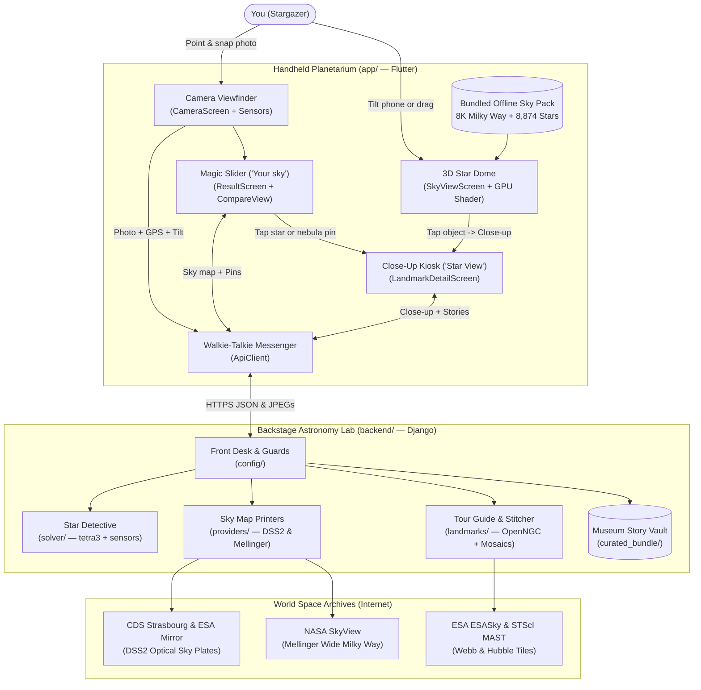

# 00 — The Big Picture: What Is NightSky?

## What NightSky Does (In Plain Words)

Have you ever looked up at the night sky, snapped a photo with your phone, and gotten back a blurry black rectangle with four tiny white dots? **NightSky** fixes that by turning your phone into a window onto real research telescopes. When you take a photo of the sky, NightSky figures out the exact patch of space your phone was pointing at and swaps your grainy photo for a crystal-clear picture of that exact same spot taken by giant astronomy surveys — complete with clickable pins on stars, nebulae, and galaxies! Even if it is cloudy, daytime, or you have no internet connection at all, you can flip a switch into **Sky View** mode to explore a live 3D virtual sky map right on your phone, tilting it around you like magic binoculars.

---

## Our Running Analogy: The Pocket Planetarium & Backstage Astronomy Lab

Throughout all of these guides, imagine NightSky as a **Pocket Planetarium** connected by a fast walkie-talkie to a **Backstage Astronomy Lab**:

- **In your hands** is the **Handheld Planetarium & Viewfinder** (`app/`), built with **Flutter** *(a toolkit for building phone apps from one set of code)*. It has two main rooms you can switch between anytime: a **Live 3D Star Dome** (`SkyViewScreen`) that works completely offline, and a **Sky Camera Window** (`CameraScreen`) for photographing the real sky.
- **Behind the scenes** on the internet is the **Backstage Astronomy Lab** (`backend/`), built with **Django** *(a Python toolkit for running web servers — computers that answer requests over the internet)*. Whenever you snap a photo, the phone radios the lab, where specialist scientists figure out where you aimed, print a matching sky map, pin famous space objects, and stitch close-ups from the **James Webb** and **Hubble** space telescopes.
- **On the creator's desk** is the **Exhibit Workshop** (`local_tools/curator/` and `app/tool/`), a set of helper tools used before shipping the app to prepare the 8K Milky Way dome wallpaper, pack star catalogs, and write museum story cards.

| Part of the Codebase | Role in Our Planetarium Analogy | What It Is For |
|---|---|---|
| `app/lib/screens/sky_view_screen.dart` + `app/lib/sky_view/` | **The Indoor 3D Star Dome** | Paints a 360° Milky Way dome, 8,874 stars, 88 constellations, the Sun, Moon, and planets right on your phone — no internet or camera needed. |
| `app/lib/screens/camera_screen.dart` | **The Sky Viewfinder Window** | Watches how steady your hands are, reads your phone's compass and **GPS** *(satellite location sensor)*, and snaps a photo of the real sky. |
| `app/lib/screens/result_screen.dart` + `CompareView` | **The Magic Transparency Slider ("Your sky")** | Stacks the lab's sharp telescope map right on top of your original photo with a sliding curtain and clickable object pins. |
| `app/lib/screens/landmark_detail_screen.dart` | **The Close-Up Exhibit Kiosk ("Star View")** | Zooms in on a single star, nebula, or galaxy to show **James Webb**, **Hubble**, sharp survey close-ups, or hand-picked museum stories. |
| `app/lib/api_client.dart` + `app/lib/state.dart` | **The Walkie-Talkie Messenger & Clipboard** | Carries photos and questions from the phone to the Backstage Lab and keeps track of what step is currently loading. |
| `backend/config/` | **The Lab Front Desk & Security Guards** | Welcomes incoming phone requests, enforces speed limits so nobody overwhelms the lab, and formats polite error messages. |
| `backend/solver/` | **The Star Detective** | Matches triangles of stars in your photo against a star fingerprint book (**plate solving** — *finding where a sky photo points by matching star patterns*), or uses your phone's tilt sensors if clouds block the stars. |
| `backend/providers/` | **The Sky Map Printers** | Fetches matching wide or close-up sky pictures from world astronomy archives (**DSS2 Color** and **Mellinger Color**) and rotates them to match your photo. |
| `backend/landmarks/` | **The Tour Guide & Space-Telescope Stitcher** | Finds famous stars and nebulae inside your photo's frame, checks if Webb or Hubble photographed them, and stitches multi-tile telescope mosaics. |
| `backend/curated/` + `local_tools/curator/` | **The Museum Story Vault & Curator's Desk** | Stores and serves hand-picked NASA/ESA highlight photos, captions, and credits (`Curated Cosmic Highlights`). |
| `app/tool/` | **The Dome Wallpaper & Catalog Press** | One-time workshop scripts that stitch 114 sky plates into an 8K Milky Way panorama and pack star catalogs into tiny files shipped inside the app. |

---

## How All the Parts Connect

---

## Who Uses NightSky — and What Goes In and Comes Out?

### Who Uses It
1. **Everyday Stargazers**: Anyone curious about what star, planet, constellation, or glowing nebula they are looking at — whether from a bright city balcony (where phone cameras barely catch a few stars) or a dark campsite without cell service.
2. **The Project Maintainer (Curator)**: Uses the private workshop tool in `local_tools/curator/` on their own computer to pick breathtaking NASA/ESA gallery photos and write friendly captions before publishing updates.

### What Goes In (Inputs)
- **In Camera Mode**:
  1. A **JPEG** *(compressed photo file)* from your phone's rear camera.
  2. **Sensor readings**: Which way the phone was tilted (**quaternion** — *a four-number math recipe that describes a 3D tilt without getting stuck at the poles*), compass heading, **GPS** latitude/longitude, current UTC time, and the camera lens's **field of view (FOV)** *(how wide an angle of sky fits in the frame, measured in degrees)*.
  3. **Taps & choices**: Which survey style you prefer (`DSS2 Color` or `Mellinger Color`) and which star or nebula marker you tap.
- **In Sky View Mode**:
  1. Live tilt and compass readings from your phone's motion chips (or your finger dragging and pinching on the glass).
  2. Observer location (phone GPS or an offline city preset like Sydney or Mauna Kea) and a chosen date/time on the **Time Machine** bar.

### What Comes Out (Outputs)
- **In Camera Mode**:
  1. **Exact Sky Coordinates**: Right Ascension (**RA** — *sky longitude*) and Declination (**Dec** — *sky latitude*), plus whether the match came from real stars in your photo or an approximate sensor estimate.
  2. **A Custom-Cut Sky Survey Picture**: A sharp astronomical image rotated and cropped to line up pixel-for-pixel over your photo so you can slide a divider back and forth between "Survey" and "My photo".
  3. **Clickable Sky Pins**: Markers over famous stars, clusters, galaxies, and nebulae in your photo (gold rings mean space-telescope images exist!).
  4. **Close-Up Portraits & Facts**: Stitched **James Webb** or **Hubble** space-telescope mosaics, sharp `DSS2 Color` close-ups,Curated Cosmic Highlights stories, brightness, apparent size, and distance in light-years.
- **In Sky View Mode**:
  1. A smooth 60-frames-per-second 3D view of the Milky Way, twinkling stars in their real temperatures/colors, constellation stick figures, horizon compass points, and live positions + phases of the Sun, Moon, and planets — plus a glowing arrow guiding you toward any object you search for!
